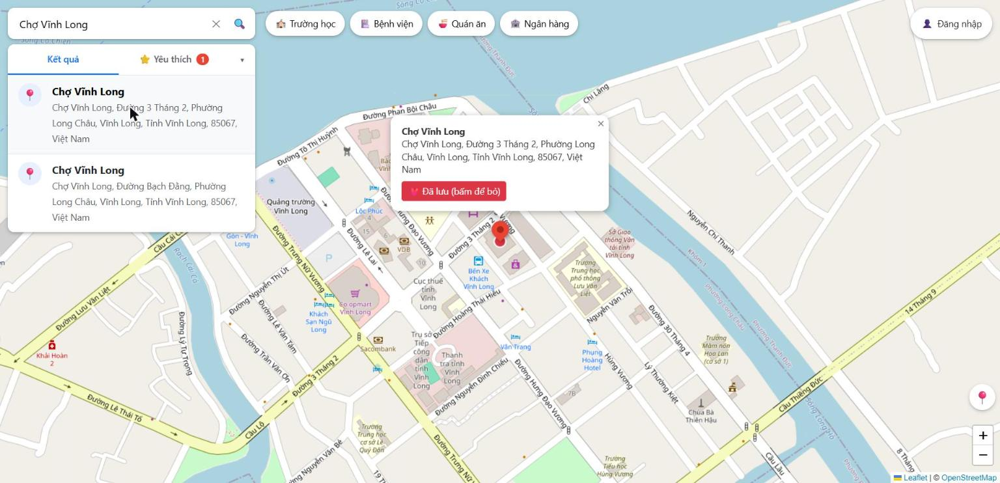
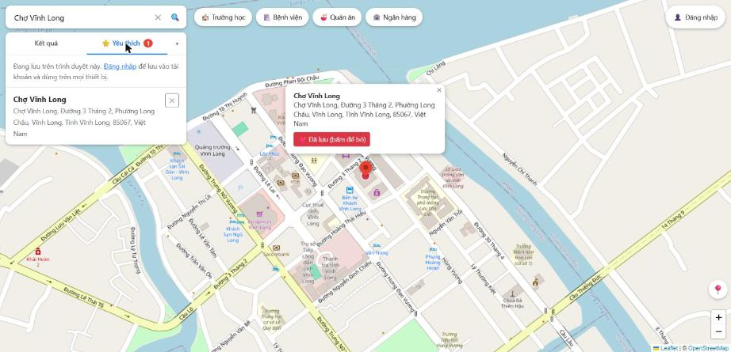

# Bản đồ tương tác - Tìm kiếm địa điểm

Ứng dụng web bản đồ tương tác cho phép tìm kiếm và xem thông tin địa điểm tại Việt Nam, lưu địa điểm yêu thích theo tài khoản và quản trị người dùng. Đây là sản phẩm của đồ án chuyên ngành *"Xây dựng ứng dụng Web bản đồ tương tác hỗ trợ tìm kiếm và hiển thị địa điểm"*.

- **Sinh viên thực hiện:** Khưu Gia Bảo - MSSV 110123004 - Lớp DA23TTA
- **Giảng viên hướng dẫn:** ThS. Lê Minh Tự
- **Đơn vị:** Khoa Công nghệ Thông tin, Trường Kỹ thuật và Công nghệ
- **Thời gian:** Học kỳ 1, năm học 2026-2027

## Chức năng

**Khách (không cần đăng nhập)**

- Xem bản đồ OpenStreetMap, phóng to, thu nhỏ, kéo thả. Bản đồ mặc định mở ở Vĩnh Long.
- Tìm địa điểm theo tên hoặc địa chỉ trong phạm vi Việt Nam.
- Tìm nhanh theo loại trong khung nhìn hiện tại: trường học, bệnh viện, quán ăn, ngân hàng.
- Bấm vào bản đồ để xem địa chỉ và tọa độ của điểm đó.
- Xác định vị trí hiện tại và hiển thị sai số.
- Lưu, xem và xóa địa điểm yêu thích ngay trên trình duyệt bằng localStorage.

**Người dùng**

- Đăng ký, đăng nhập, đăng xuất và đổi mật khẩu.
- Lưu, xem và xóa địa điểm yêu thích trong cơ sở dữ liệu, dùng được trên mọi trình duyệt.
- Yêu thích đã lưu khi còn là khách được tự chuyển vào tài khoản khi đăng nhập. Mục nào không chuyển được (dữ liệu lỗi hoặc vượt giới hạn) vẫn được giữ trên trình duyệt.

**Quản trị viên** (trang `/admin.html`)

- Xem thống kê người dùng, địa điểm đã lưu và các địa điểm được lưu nhiều nhất.
- Tìm kiếm người dùng, cấp hoặc hạ quyền admin, khóa hoặc mở khóa, đặt lại mật khẩu, xóa tài khoản.
- Tìm kiếm và xóa địa điểm yêu thích của người dùng.

## Công nghệ

| Thành phần | Công nghệ |
|---|---|
| Giao diện | HTML5, CSS3, Bootstrap 5.3.3 (chỉ dùng CSS), JavaScript thuần |
| Bản đồ | Leaflet 1.9.4, OpenStreetMap |
| Tìm kiếm và tra địa chỉ | Nominatim |
| Máy chủ | Node.js, Express 5 |
| Cơ sở dữ liệu | SQLite (`node:sqlite` có sẵn trong Node.js) |
| Bảo mật | scrypt, cookie HttpOnly, Helmet (CSP), giới hạn tần suất đăng nhập |
| Kiểm thử | `node:test` |

## Cài đặt và chạy

Yêu cầu: Node.js 22.16 trở lên và có Internet.

```powershell
cd web-ban-do
npm install
npm run create-admin -- quantri   # Tạo admin đầu tiên, nhập mật khẩu khi được hỏi
npm start
```

Sau đó mở <http://localhost:3000>. CSDL được tạo tự động tại `data/ban-do.db`. Muốn có sẵn dữ liệu để demo, chạy `npm run db:seed` và ghi lại mật khẩu được in ra.

| Lệnh | Tác dụng |
|---|---|
| `npm start` | Chạy ứng dụng |
| `npm run dev` | Chạy và tự khởi động lại khi sửa mã nguồn máy chủ |
| `npm test` | Chạy kiểm thử API và CSDL |
| `npm run create-admin -- <tên>` | Tạo admin, hoặc nâng tài khoản có sẵn lên admin và đặt lại mật khẩu |
| `npm run db:status` | Xem phiên bản, số dòng và trạng thái toàn vẹn của CSDL |
| `npm run db:backup` | Sao lưu CSDL vào `data/backups/` |
| `npm run db:restore -- <file>` | Phục hồi CSDL, phải dừng ứng dụng trước |

Có thể đổi cổng và đường dẫn CSDL bằng file `.env`, xem mẫu tại `.env.example`.

Không có tài khoản admin mặc định; hãy tạo bằng lệnh trên. Chạy lại lệnh cho một tài khoản có sẵn sẽ đặt lại mật khẩu và đăng xuất tài khoản đó khỏi mọi thiết bị.

Khi chạy thật qua HTTPS, đặt `NODE_ENV=production` để cookie phiên có cờ `Secure`. Nếu đặt sau reverse proxy như nginx, đặt thêm `TRUST_PROXY` (xem `.env.example`) để giới hạn đăng nhập sai tính theo IP thật của từng người.

## Cách sử dụng



1. Nhập từ khóa vào ô tìm kiếm rồi nhấn Enter, hoặc chọn một nút loại địa điểm.
2. Bấm vào một kết quả để bay tới vị trí đó và mở thông tin chi tiết.
3. Trong popup, bấm **Lưu yêu thích** để lưu địa điểm. Bấm lại để bỏ lưu. Khi chưa đăng nhập, địa điểm được lưu trên trình duyệt này.
4. Mở tab **Yêu thích** để xem danh sách. Bấm vào tên để tới địa điểm, bấm ✕ để xóa.
5. Bấm vị trí bất kỳ trên bản đồ để xem địa chỉ.
6. Bấm nút 📍 và cho phép truy cập vị trí để tìm vị trí của bạn.
7. Bấm nút **Đăng nhập** ở góc trên để đăng nhập hoặc đăng ký. Yêu thích đã lưu trên trình duyệt được chuyển vào tài khoản.
8. Admin bấm vào tên tài khoản rồi chọn **Mở trang quản trị**.



## Cấu trúc thư mục

```text
web-ban-do/
├── public/            Giao diện phục vụ cho trình duyệt
│   ├── index.html     Trang bản đồ
│   ├── admin.html     Trang quản trị
│   ├── css/style.css
│   └── js/
├── server/            Máy chủ Express
│   ├── app.js         Cấu hình ứng dụng và bảo mật
│   ├── auth.js        Mật khẩu, phiên đăng nhập, phân quyền
│   ├── db.js          Mở CSDL, migration, sao lưu và phục hồi
│   ├── seed.js        Dữ liệu mẫu
│   ├── migrations/    Lược đồ CSDL theo phiên bản
│   ├── routes/        API auth, favorites, admin
│   └── scripts/       Lệnh tạo admin và quản lý CSDL
├── test/              Kiểm thử API và CSDL
├── docs/
│   ├── phan-tich-yeu-cau.md  Khảo sát và phân tích yêu cầu
│   ├── database.md    Thiết kế CSDL
│   ├── kiem-thu.md    Kế hoạch và kết quả kiểm thử
│   ├── so-do/         Sơ đồ kiến trúc, use case, ERD, tuần tự (draw.io)
│   └── screenshots/   Ảnh chụp màn hình
└── data/              File CSDL và bản sao lưu (tạo khi chạy)
```

## Sơ đồ thiết kế

Các file `.drawio.png` trong `docs/so-do/` là ảnh để chèn vào báo cáo, đồng thời mở được bằng draw.io để chỉnh sửa.

| Sơ đồ | File |
|---|---|
| Kiến trúc hệ thống | [kien-truc.drawio.png](docs/so-do/kien-truc.drawio.png) |
| Use case | [use-case.drawio.png](docs/so-do/use-case.drawio.png) |
| Quan hệ thực thể (ERD) | [erd.drawio.png](docs/so-do/erd.drawio.png) |
| Tuần tự lưu yêu thích và đăng nhập | [tuan-tu-yeu-thich.drawio.png](docs/so-do/tuan-tu-yeu-thich.drawio.png) |

## Cơ sở dữ liệu

Ứng dụng dùng SQLite, gồm các bảng sau. Sơ đồ quan hệ, từ điển dữ liệu và cách quản lý nằm trong [docs/database.md](docs/database.md).

| Bảng | Nội dung |
|---|---|
| `users` | Tên đăng nhập, bản băm mật khẩu, vai trò `user` hoặc `admin`, trạng thái khóa |
| `sessions` | Bản băm mã phiên đăng nhập và thời hạn 7 ngày |
| `favorites` | Địa điểm yêu thích của từng người dùng |

Xóa người dùng sẽ xóa luôn phiên và địa điểm yêu thích của người đó. Mỗi người dùng lưu được tối đa 500 địa điểm.

## Phạm vi và giới hạn

- Không có chức năng chỉ đường.
- Không có email nên không có quên mật khẩu tự động; admin đặt lại mật khẩu tạm cho người dùng.
- Admin xem được địa điểm yêu thích của mọi người dùng.
- Kết quả tìm kiếm phụ thuộc vào dữ liệu OpenStreetMap, tối đa 10 kết quả mỗi lần.
- Nominatim công cộng giới hạn tối đa 1 yêu cầu mỗi giây.

## Nguồn dữ liệu

Dữ liệu bản đồ © [Những người đóng góp OpenStreetMap](https://www.openstreetmap.org/copyright).
# CN-DA23TTA-khuugiabao-MapSearch

