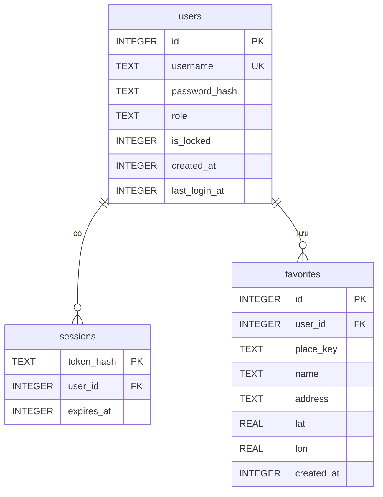

# Thiết kế cơ sở dữ liệu

Ứng dụng dùng **SQLite** qua module `node:sqlite` của Node.js. Toàn bộ dữ liệu nằm trong một file, mặc định là `data/ban-do.db`.

## Sơ đồ quan hệ

Mỗi người dùng có nhiều phiên đăng nhập và nhiều địa điểm yêu thích. Lược đồ đạt dạng chuẩn 3 (3NF), trừ một chủ đích: `favorites` lưu trực tiếp tên và địa chỉ thay vì tách bảng địa điểm, vì địa điểm đến từ OpenStreetMap và ứng dụng không quản lý danh mục địa điểm riêng. Nhờ đó dữ liệu người dùng đã lưu không đổi khi OpenStreetMap thay đổi.

Thời gian lưu dạng số mili giây kể từ 1970, là giá trị của `Date.now()`.

## Từ điển dữ liệu

### `users` - Tài khoản

| Cột | Kiểu | Ràng buộc | Ý nghĩa |
|---|---|---|---|
| `id` | INTEGER | Khóa chính | Mã người dùng |
| `username` | TEXT | Bắt buộc, duy nhất, không phân biệt hoa thường, 3-30 ký tự | Tên đăng nhập |
| `password_hash` | TEXT | Bắt buộc | Mật khẩu đã băm bằng scrypt kèm salt |
| `role` | TEXT | `user` hoặc `admin`, mặc định `user` | Vai trò |
| `is_locked` | INTEGER | 0 hoặc 1, mặc định 0 | Tài khoản bị khóa |
| `created_at` | INTEGER | Bắt buộc | Thời điểm tạo |
| `last_login_at` | INTEGER | Có thể rỗng | Lần đăng nhập gần nhất |

### `sessions` - Phiên đăng nhập

| Cột | Kiểu | Ràng buộc | Ý nghĩa |
|---|---|---|---|
| `token_hash` | TEXT | Khóa chính | SHA-256 của mã phiên trong cookie |
| `user_id` | INTEGER | Khóa ngoại tới `users`, xóa theo tầng | Chủ phiên |
| `expires_at` | INTEGER | Bắt buộc | Thời điểm hết hạn, sau 7 ngày |

### `favorites` - Địa điểm yêu thích

| Cột | Kiểu | Ràng buộc | Ý nghĩa |
|---|---|---|---|
| `id` | INTEGER | Khóa chính | Mã bản ghi |
| `user_id` | INTEGER | Khóa ngoại tới `users`, xóa theo tầng | Người lưu |
| `place_key` | TEXT | Bắt buộc, duy nhất theo `user_id` | Tọa độ làm tròn 5 chữ số kèm tên, dạng `lat,lon\|tên`, để hai địa điểm trùng tọa độ (vd. cửa hàng trong tòa nhà) vẫn tách biệt |
| `name` | TEXT | 1-200 ký tự | Tên địa điểm |
| `address` | TEXT | Tối đa 500 ký tự | Địa chỉ |
| `lat` | REAL | Từ -90 đến 90 | Vĩ độ |
| `lon` | REAL | Từ -180 đến 180 | Kinh độ |
| `created_at` | INTEGER | Bắt buộc | Thời điểm lưu |

## Chỉ mục

| Chỉ mục | Phục vụ |
|---|---|
| `idx_users_created` | Danh sách người dùng mới nhất ở trang quản trị |
| `idx_sessions_user` | Xóa mọi phiên của một người dùng |
| `idx_sessions_expires` | Dọn phiên hết hạn |
| `idx_favorites_user_created` | Danh sách yêu thích của một người dùng |
| `idx_favorites_created` | Danh sách yêu thích toàn hệ thống |
| `idx_favorites_place` | Thống kê địa điểm được lưu nhiều nhất |

## Toàn vẹn dữ liệu

- Tất cả bảng là `STRICT`, nên SQLite từ chối sai kiểu dữ liệu.
- Ràng buộc `CHECK` lặp lại các kiểm tra của API, là lớp bảo vệ cuối nếu API có lỗi.
- Khóa ngoại được bật ở mọi kết nối. Xóa người dùng sẽ xóa luôn phiên và địa điểm yêu thích.
- Chế độ WAL cho phép đọc trong lúc đang ghi.

## Quản lý

| Lệnh | Tác dụng |
|---|---|
| `npm run db:migrate` | Tạo CSDL hoặc nâng lên lược đồ mới nhất |
| `npm run db:status` | Xem phiên bản, số migration còn thiếu, số dòng và kết quả kiểm tra toàn vẹn |
| `npm run db:seed` | Thêm dữ liệu mẫu để demo |
| `npm run db:backup` | Sao lưu vào `data/backups/`, được phép khi ứng dụng đang chạy |
| `npm run db:restore -- <file>` | Phục hồi từ bản sao lưu, phải dừng ứng dụng trước |

`npm start` cũng tự áp dụng migration còn thiếu. `db:status` và `db:backup` thì không, để thấy đúng hiện trạng và sao lưu được bản trước khi nâng cấp. Quy trình nâng cấp an toàn: dừng ứng dụng, `db:backup`, rồi `db:migrate` hoặc `npm start`.

### Lịch sử lược đồ

| Phiên bản | File | Nội dung |
|---|---|---|
| 1 | `001_khoi_tao.sql` | Tạo 3 bảng, ràng buộc và chỉ mục |
| 2 | `002_khoa_dia_diem_theo_ten.sql` | Thêm tên vào `place_key` của dữ liệu có sẵn |

### Dữ liệu mẫu

`db:seed` tạo 4 tài khoản: `demo.admin`, `demo.an`, `demo.binh` và `demo.khoa` (đang bị khóa), cùng 7 lượt lưu địa điểm thật ở Vĩnh Long. Mật khẩu chung được sinh ngẫu nhiên và chỉ hiện một lần, nên hãy ghi lại ngay. Chạy lại không tạo trùng và không đổi mật khẩu. Lệnh bị chặn khi `NODE_ENV=production`.

### Thay đổi lược đồ

Thêm file `server/migrations/NNN_mo_ta.sql`, với `NNN` là số tiếp theo. Không sửa migration đã áp dụng lên CSDL thật.

Phiên bản lược đồ lưu trong `PRAGMA user_version`. Mỗi migration chạy trong một giao dịch, nên lỗi giữa chừng sẽ hoàn tác toàn bộ file đó. File migration không được tự viết `BEGIN` hay `COMMIT`. Ứng dụng từ chối mở CSDL có phiên bản mới hơn mã nguồn.

### Phục hồi

`db:restore` kiểm tra file sao lưu trước, lưu bản hiện tại thành `data/backups/truoc-phuc-hoi-*.db` rồi mới thay thế. CSDL hiện tại được giữ nguyên khi file sao lưu bị từ chối, gồm các trường hợp:

- file hỏng,
- không phải CSDL của ứng dụng,
- tạo bởi phiên bản ứng dụng mới hơn.

Nếu CSDL hiện tại hỏng đến mức không đọc được, file gốc được sao chép nguyên trạng làm bản lưu trước khi phục hồi.

Khi chạy, ứng dụng ghi PID vào `data/ban-do.db.lock` và xóa khi dừng. `db:restore` từ chối chạy nếu tiến trình trong file khóa còn sống, và ứng dụng thứ hai cũng không khởi động được trên cùng CSDL. Khóa còn sót lại do ứng dụng bị tắt đột ngột được tự bỏ qua.
